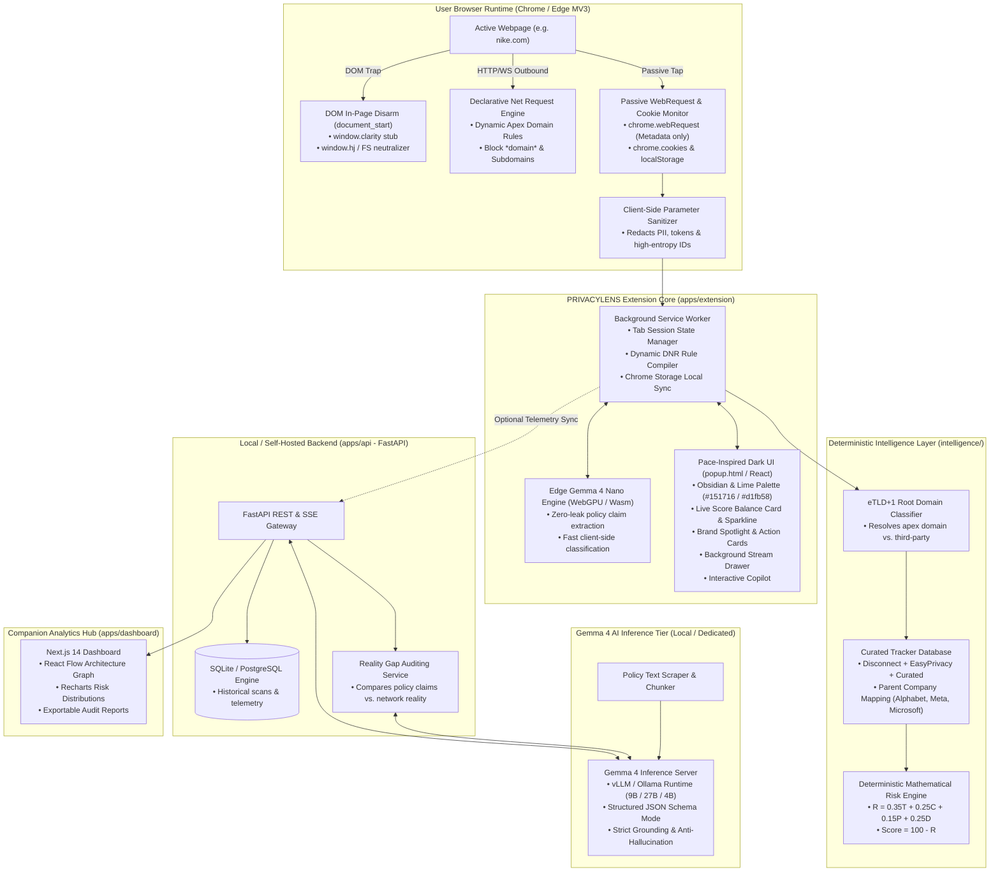
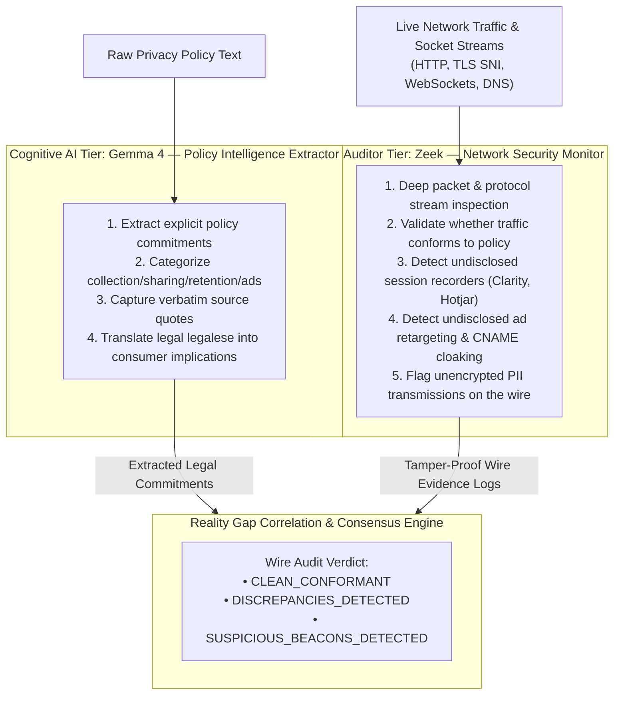
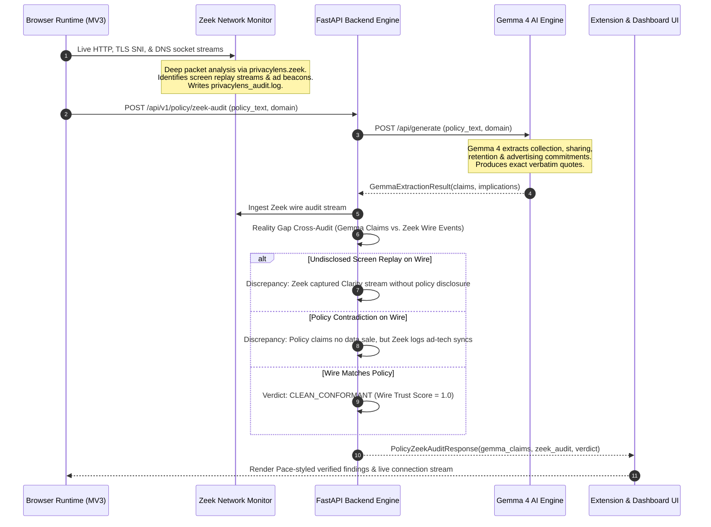
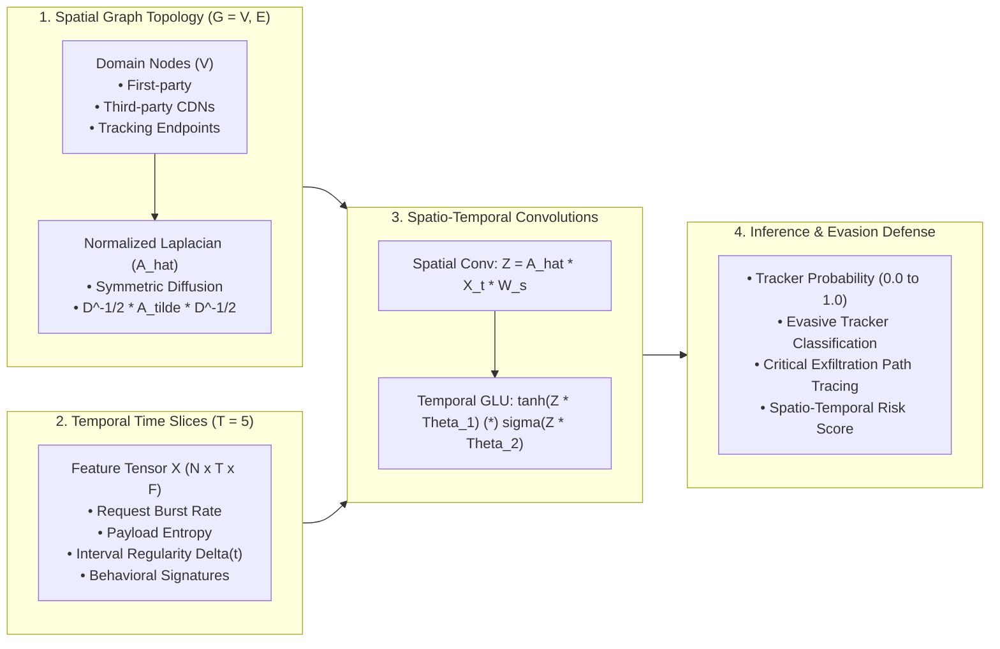

# PRIVACYLENS — System Architecture Specification
## Evidence-Backed, Real-Time AI Privacy Inspector with Gemma 4 Integration

```
  ██████╗ ██████╗ ██╗██╗   ██╗ █████╗  ██████╗██╗   ██╗██╗     ███████╗███╗   ██╗███████╗
  ██╔══██╗██╔══██╗██║██║   ██║██╔══██╗██╔════╝╚██╗ ██╔╝██║     ██╔════╝████╗  ██║██╔════╝
  ██████╔╝██████╔╝██║██║   ██║███████║██║      ╚████╔╝ ██║     █████╗  ██╔██╗ ██║███████╗
  ██╔═══╝ ██╔══██╗██║╚██╗ ██╔╝██╔══██║██║       ╚██╔╝  ██║     ██╔══╝  ██║╚██╗██║╚════██║
  ██║     ██║  ██║██║ ╚████╔╝ ██║  ██║╚██████╗   ██║   ███████╗███████╗██║ ╚████║███████║
  ╚═╝     ╚═╝  ╚═╝╚═╝  ╚═══╝  ╚═╝  ╚═╝ ╚═════╝   ╚═╝   ╚══════╝╚══════╝╚═╝  ╚═══╝╚══════╝
                     SEE WHAT WEBSITES DO NOT TELL YOU.
```

---

## 1. Executive Summary & Architectural Vision

Traditional privacy extensions fall into two flawed extremes:
1. **Naive Summarizers**: Pass lengthy privacy policy legal text into remote LLMs, hallucinating summaries without knowing what code the site actually executes.
2. **Black-Box Blockers**: Silently block lists of domains without explaining what data was being captured, whether the website disclosed it, or how third-party trackers bypass cookie consent.

**PRIVACYLENS** is an evidence-grounded, multi-tier privacy inspection platform. It observes client-side browser events in real time, extracts published legal commitments from privacy policies using **Gemma 4**, and deterministically calculates the **Privacy Reality Gap**—the measurable discrepancy between legal claims and runtime behavior.

### Core Architectural Tenets
- **Deterministic Foundation**: Tracker detection, network interception, domain ownership resolution, and risk scores are calculated using deterministic formulas and curated databases. The AI never guesses raw scores or tracker identities.
- **Privacy-First AI via Gemma 4**: Powered by Google's open weights **Gemma 4** model architecture deployed in dual modes: lightweight on-device WebGPU execution for zero-leak local parsing, and local containerized vLLM/Ollama inference for deep policy auditing and copilot guidance.
- **Zero-Telemetry Leakage**: All network telemetry is sanitized client-side before processing. Sensitive query parameters (`tokens`, `passwords`, `PII`, `UUIDs`) are redacted before entering memory or AI prompts.
- **Active Network & DOM Defense**: Real-time Declarative Net Request (DNR) dynamic rule compilation coupled with in-DOM recorder neutralization stops screen recorders (Clarity, Hotjar, FullStory) at the root level.

---

## 2. High-Level System Architecture

The following diagram illustrates the complete end-to-end data flow across client browser runtimes, intelligence engines, the Gemma 4 reasoning pipeline, and user interfaces:



---

## 3. The Three-Tier Intelligence Separation

To eliminate hallucinations and guarantee legal and technical credibility, PRIVACYLENS enforces a strict architectural boundary across three tiers:

```
┌────────────────────────────────────────────────────────────────────────┐
│                      TIER 1: DETERMINISTIC ENGINE                      │
│ • Passive chrome.webRequest metadata capture (No payload snooping)     │
│ • Canonical eTLD+1 first-party vs. third-party domain resolution       │
│ • Curated registry matching (EasyPrivacy, Disconnect, PrivacyLens DB)  │
│ • Cookie flags inspection: Secure, HttpOnly, SameSite, Expiration      │
│ • LocalStorage high-entropy UUID tracking identifier inspection        │
│ • Declarative Net Request (DNR) dynamic rule installation & blocking   │
└───────────────────────────────────┬────────────────────────────────────┘
                                    │ Observed Concrete Evidence
┌───────────────────────────────────▼────────────────────────────────────┐
│                        TIER 2: RISK ENGINE                             │
│ • Deterministic Calibrated Scoring: R = 0.35T + 0.25C + 0.15P + 0.25D  │
│ • Safety Balance: Score = 100 - R (0 to 100 scale, Grade A+ to F)     │
│ • Reality Gap Identification:                                          │
│     - Policy says "no tracking" ──> Ad tracker observed (DISCREPANCY)  │
│     - Session recorder active ──> No explicit disclosure (DISCREPANCY) │
│ • Strictly categorized: Consistent | Inconsistent | Unverifiable       │
└───────────────────────────────────┬────────────────────────────────────┘
                                    │ Grounded Evidence Graph & Claims
┌───────────────────────────────────▼────────────────────────────────────┐
│                    TIER 3: GEMMA 4 REASONING ENGINE                    │
│ • Zero-telemetry-leak structured policy claim extraction into JSON     │
│ • Plain-English consumer translations of dense legal disclosures       │
│ • Evidence-Grounded Privacy Copilot with mandatory token citations     │
│ • Strict refusal guardrails: refuses to speculate without evidence     │
└────────────────────────────────────────────────────────────────────────┘
```

---

## 4. Dual-Engine Architecture: Gemma 4 (Policy Intelligence) & Zeek (Independent Wire Auditor)

Text-only AI models cannot verify physical network reality—they can only analyze words. To achieve bulletproof, legally verifiable privacy inspection, PRIVACYLENS combines **Google's Gemma 4 (Cognitive Policy Intelligence)** with **Zeek (Network Security Monitor & Deep Packet Auditor)**:



---

### 4.1 Separation of Responsibilities: Gemma 4 vs. Zeek

| Dimension | Gemma 4 (Policy Intelligence Engine) | Zeek (Independent Wire Auditor) |
| :--- | :--- | :--- |
| **Primary Domain** | Legal & Semantic Disclosure Analysis | Physical Network Packets & Protocol Streams |
| **Core Responsibilities** | • Extract privacy policy commitments<br>• Identify collection, sharing, retention, and advertising disclosures<br>• Return structured JSON with exact verbatim evidence excerpts<br>• Explain the consumer implications of legal language | • Deep protocol inspection (HTTP headers, TLS SNI, DNS queries, WebSockets)<br>• Independent verification against actual network wire evidence<br>• Detect undisclosed session replay telemetry (Clarity, Hotjar, FullStory)<br>• Detect cross-site ad beacons and CNAME cloaking<br>• Flag anomalous or unencrypted transmissions for human review |
| **Input Data** | Raw privacy policy text chunks | Live network interface / PCAP socket streams |
| **Output Data** | `GemmaExtractionResult` (Claims, quotes, implications) | `ZeekAuditReport` (Captured trackers, discrepancies, wire verdict) |
| **Execution Environment** | Local Ollama/vLLM (`gemma4:9b`) or WebGPU Nano | Native Zeek container (`zeek/zeek:6.0.3`) with `privacylens.zeek` |

---

### 4.2 End-to-End Execution Flow: Gemma 4 + Zeek



---

### 4.3 Model 1: Gemma 4 Extraction Specification

#### Prompt Template
```jinja2
<start_of_turn>user
You are the PRIVACYLENS Policy Intelligence Extractor powered by Gemma 4.
Analyze the following privacy policy for domain: "{{ domain }}".

Your Responsibilities:
1. Extract explicit policy commitments across these categories:
   - "data_collection"
   - "third_party_sharing"
   - "advertising_targeting"
   - "data_retention"
   - "user_rights"
   - "data_sale"
2. For every commitment, quote the EXACT verbatim sentence from the text as "source_excerpt".
3. Provide a clear, non-technical plain English translation as "legal_implication".
4. List all third-party entities disclosed as "entities_disclosed".

Output strictly valid JSON:
{
  "executive_summary": "1-2 sentence plain-English summary of what this website discloses",
  "claims": [
    {
      "category": "third_party_sharing",
      "claim_text": "We share analytics data with trusted partners.",
      "legal_implication": "Your activity is shared with analytics vendors like Google to monitor site traffic.",
      "entities_disclosed": ["Google", "Analytics Partners"],
      "source_excerpt": "We may share aggregated or de-identified information with partners...",
      "confidence": 0.95,
      "is_explicit": true
    }
  ]
}

Policy Text:
"""
{{ policy_text }}
"""
<end_of_turn>
<start_of_turn>model
```

---

### 4.4 Auditor: Zeek Inspection Script (`privacylens.zeek`)

The Zeek network auditor executes protocol analysis on raw network sockets:

```zeek
##! PRIVACYLENS — Zeek Privacy & Tracker Wire Audit Script
@load base/protocols/http
@load base/protocols/ssl
@load base/protocols/dns

module PrivacyLens;

export {
    redef enum Log::ID += { LOG };

    type Info: record {
        ts: time &log;
        uid: string &log;
        proto: string &log;
        host: string &log;
        uri: string &log &optional;
        method: string &log &optional;
        is_tracker: bool &log &default=F;
        tracker_name: string &log &optional;
        tracker_category: string &log &optional;
        is_screen_recorder: bool &log &default=F;
        audit_note: string &log &optional;
    };

    global log_privacy: event(rec: Info);
}

event zeek_init() &priority=5 {
    Log::create_stream(PrivacyLens::LOG, [$columns=Info, $ev=log_privacy, $path="privacylens_audit"]);
}

# Inspect HTTP requests for session replay and ad tracking beacons
event http_request(c: connection, method: string, original_URI: string, unescaped_URI: string, version: string) {
    local host = c$http?$host ? c$http$host : "";
    local is_trk = F;
    local is_recorder = F;
    local trk_name = "";
    local trk_cat = "";

    if ( /clarity\.ms/ in host ) {
        is_trk = T; is_recorder = T;
        trk_name = "Microsoft Clarity"; trk_cat = "screen_recording";
    } else if ( /hotjar\.(com|io)/ in host ) {
        is_trk = T; is_recorder = T;
        trk_name = "Hotjar"; trk_cat = "screen_recording";
    } else if ( /fullstory\.com/ in host ) {
        is_trk = T; is_recorder = T;
        trk_name = "FullStory"; trk_cat = "screen_recording";
    } else if ( /facebook\.(net|com)/ in host ) {
        is_trk = T; trk_name = "Meta Pixel"; trk_cat = "advertising";
    }

    if ( is_trk ) {
        local rec: PrivacyLens::Info = [
            $ts = network_time(),
            $uid = c$uid,
            $proto = "http",
            $host = host,
            $uri = original_URI,
            $method = method,
            $is_tracker = T,
            $tracker_name = trk_name,
            $tracker_category = trk_cat,
            $is_screen_recorder = is_recorder,
            $audit_note = is_recorder ? "Screen replay stream observed on wire" : "Third-party ad beacon"
        ];
        Log::write(PrivacyLens::LOG, rec);
    }
}
```

---

### 4.5 Reality Gap Decision Tree: Gemma 4 vs. Zeek

```
┌────────────────────────────────────────────────────────────────────────┐
│                   REALITY GAP CORRELATION DECISION TREE                │
└───────────────────────────────────┬────────────────────────────────────┘
                                    │
           ┌────────────────────────┴────────────────────────┐
           ▼                                                 ▼
[Zeek Captures Screen Replay Packets?]            [Zeek Captures Third-Party Ad Beacons?]
           │                                                 │
      YES  │                                            YES  │
           ▼                                                 ▼
[Gemma Found Screen Replay Disclosure?]           [Gemma Found Ad Retargeting Disclosure?]
           │                                                 │
       NO  ▼                                             NO  ▼
[UNDISCLOSED_SCREEN_RECORDER DISCREPANCY]         [UNDISCLOSED_AD_RETARGETING DISCREPANCY]
• Severity: CRITICAL (-35 Safety Penalty)         • Severity: HIGH (-20 Safety Penalty)
• Reality Gap finding generated                   • Reality Gap finding generated
           │                                                 │
      YES  ▼                                            YES  ▼
┌────────────────────────────────────────────────────────────────────────┐
│                            WIRE CONFORMANT                             │
│ • Physical network streams strictly match published policy disclosures │
│ • Zeek Network Trust Score = 1.0 (Pristine Audit)                      │
└────────────────────────────────────────────────────────────────────────┘
```

---

### 4.6 Zeek Console Log Testing & Protocol Ingestion Architecture

Zeek logs network events at the kernel and packet capture layers into structured streams:
- `privacylens_audit.log`: Dedicated privacy monitoring log containing host, URI, method, tracker categorization, screen recording flags, and CNAME cloaking targets.
- `dns.log`: DNS query-response log used to detect first-party CNAME cloaking (e.g. `analytics.domain.com` alias resolving to `c.clarity.ms`).
- `ssl.log`: Encrypted TLS handshake log inspecting Server Name Indication (SNI) for stealthy WebSocket or encrypted replay streams.

#### Live Zeek Console Log Output Format
```text
[ZEEK WIRE AUDIT] [SCREEN REPLAY DETECTED] UID: C_uid_001 | HTTP | [POST] c.clarity.ms | Note: Active screen replay session telemetry captured on wire
[ZEEK WIRE AUDIT] [TRACKER: Meta Pixel]   UID: C_uid_002 | HTTP | [GET] connect.facebook.net | Note: Cross-site ad retargeting pixel beacon
[ZEEK WIRE AUDIT] [CLEAN]                  UID: C_uid_003 | HTTP | [GET] static.nike.com | Note: Legitimate first-party stylesheet
[ZEEK WIRE AUDIT] [CNAME CLOAKED -> c.clarity.ms] UID: C_uid_004 | HTTP | [POST] analytics.store.nike.com | Note: CNAME cloaked first-party proxy
[ZEEK WIRE AUDIT] [SCREEN REPLAY DETECTED] UID: C_uid_005 | SSL  | script.hotjar.com | Note: TLS SNI handshake to screen replay domain
```

---

### 4.7 Spatio-Temporal Graph Neural Network (STGNN) Tracker Intelligence

To detect sophisticated evasive trackers that bypass static blocklists using CNAME cloaking, first-party proxying, and distributed cookie syncing, PRIVACYLENS implements a **Spatio-Temporal Graph Neural Network (STGNN)**:



#### Key Capabilities of the PRIVACYLENS STGNN:
1. **Dynamic Topology**: Represents all domains participating in a page visit as graph vertices, with directed edges representing script injections, cookie-syncing calls, and XHR beacons.
2. **Temporal Cadence Modeling**: Differentiates between benign static assets (loaded once during initial DOM parse) versus evasive telemetry beacons (periodic background heartbeats or real-time event streaming).
3. **Critical Data Leakage Path Tracing**: Computes the highest-centrality exfiltration route from First-Party $\to$ Intermediate Proxy $\to$ Data Broker.
4. **Evasion Resistance**: Accurately classifies unclassified or cloaked domains based on their topological position and temporal burstiness.

---

#### Copilot Anti-Hallucination Prompt Template
```jinja2
<start_of_turn>user
You are the PRIVACYLENS AI Copilot, powered by Gemma 4.
Your objective is to answer the user's privacy inquiry regarding the website "{{ domain }}" in clear, empathetic, non-technical plain English.

CRITICAL INSTRUCTIONS:
1. Ground your answer EXCLUSIVELY on the verified evidence below.
2. If evidence for a specific question does not exist, explicitly state: "No network or storage evidence observed on this page indicates that."
3. Never state that a tracker "illegally steals passwords" unless cryptographic theft was detected. Standard ad trackers record navigation, not passwords.
4. Reference every tracker using an evidence citation token: [EVIDENCE:destinationDomain].

[OBSERVED TELEMETRY EVIDENCE]
Domain: {{ domain }}
Overall Safety Score: {{ score.overall_privacy_score }}/100 (Grade {{ score.grade }})
Verified Trackers Observed:

- {{ t.tracker_name }} (Owner: {{ t.owner }}): Category {{ t.category }}, Domain {{ t.destination_domain }}, Blocked: {{ t.blocked }}

Storage & Cookie Exposure:
- Total Cookies: {{ cookies|length }}
- Session Recorders Active: {{ has_screen_recording }} (Blocked: {{ is_recording_blocked }})

User Question: "{{ question }}"
<end_of_turn>
<start_of_turn>model
```

---

## 5. Mathematical Scoring Engine Specification

The deterministic Privacy Score is computed across four threat vectors with mathematically calibrated penalty weights:

$$\text{Risk Score } R = \min(100, \; 0.35 T + 0.25 C + 0.15 P + 0.25 D)$$

$$\text{Privacy Safety Score} = 100 - R$$

### Vector Breakdown

```
 0.35 × T (Tracking Exposure)
 ├── Active Third-Party Tracker Count (Linear penalty up to 5 trackers)
 ├── Session Replay & Screen Recorders (Clarity, Hotjar, FullStory): +35 pts
 ├── Hardware / Canvas Device Fingerprinting: +35 pts
 └── Cross-Site Behavioral Retargeting: +18 pts per distinct network

 0.25 × C (Cookie & Storage Exposure)
 ├── Missing 'Secure' flag on cookies: +15 pts
 ├── Missing 'HttpOnly' flag on sensitive tokens: +20 pts
 ├── Persistent retention (> 180 days expiration): +12 pts
 └── High-Entropy UUID / Device ID in localStorage: +25 pts

 0.15 × P (Browser Permissions Granted)
 ├── Geolocation access granted: +30 pts
 ├── Camera / Microphone access granted: +45 pts
 └── Push Notifications permission granted: +15 pts

 0.25 × D (Disclosure & Reality Gap)
 ├── Complete lack of accessible privacy policy: +40 pts
 ├── Undisclosed advertising retargeting (Observed without disclosure): +35 pts
 └── Unspecified third-party data sharing clause: +20 pts
```

### Grade Calibration Table

| Privacy Score | Letter Grade | UI Badge State | Consumer Interpretation |
| :---: | :---: | :---: | :--- |
| **90 – 100** | **Grade A+** | `PROTECTED` (Lime `#d1fb58`) | Pristine privacy. Zero third-party trackers or recording scripts. |
| **80 – 89** | **Grade A** | `GOOD` (Green) | Essential functional cookies only; fully disclosed analytics. |
| **70 – 79** | **Grade B** | `NOTICE` (Graphite `#8e928f`) | Standard commercial tracking. Social pixels or visitor analytics present. |
| **55 – 69** | **Grade C** | `ALERT` (Coral `#ff8e77`) | Heavy advertising networks, long-lived tracking cookies. |
| **35 – 54** | **Grade D** | `HIGH RISK` (Coral `#ff8e77`) | Undisclosed trackers, high-entropy device fingerprinting. |
| **0 – 34** | **Grade F** | `CRITICAL HAZARD` (Red) | Active screen replay recording mouse/keystrokes with no disclosure. |

---

## 6. Monorepo Architecture & Directory Structure

The project is structured as a high-velocity TypeScript and Python monorepo managed with `pnpm` workspaces:

```
c:\Users\parth\Downloads\WIN/
├── apps/
│   ├── extension/                     # Chrome / Edge MV3 Extension (Vite, React, Tailwind)
│   │   ├── src/
│   │   │   ├── background/            # MV3 Service Worker (Session state, DNR compiler)
│   │   │   ├── content/               # Content Script (document_start DOM disarm & storage)
│   │   │   ├── popup/                 # Pace Dark Obsidian Popup Dashboard
│   │   │   └── ai/                    # Edge Gemma 4 WebGPU worker integration
│   │   ├── manifest.json              # MV3 configuration with DNR & Tabs permissions
│   │   └── vite.config.ts             # Vite multi-entry extension bundler
│   │
│   ├── dashboard/                     # Next.js 14 Companion Analytics Dashboard
│   │   ├── src/app/                   # App Router (Scans, Reality Gap matrix, Graph)
│   │   └── src/components/            # React Flow interactive architecture viewer
│   │
│   └── api/                           # FastAPI Intelligence & Backend API
│       ├── app/
│       │   ├── models/                # SQLAlchemy database models
│       │   ├── routes/                # REST endpoints: /scans, /policy, /copilot, /trackers
│       │   ├── schemas/               # Pydantic schemas (mirrors packages/shared)
│       │   └── services/              # Gemma 4 service, Policy Analyzer, Risk Engine
│       └── requirements.txt           # Python dependencies (FastAPI, uvicorn, vLLM/httpx)
│
├── intelligence/                      # Deterministic Domain & Tracker Core
│   ├── tracker_database/              # Curated Disconnect/EasyPrivacy registry (trackers.json)
│   ├── domain_classifier/             # eTLD+1 apex vs. third-party classifier
│   └── risk_engine/                   # Deterministic TypeScript scoring implementation
│
├── packages/
│   └── shared/                        # Universal shared TypeScript contracts & models
│       └── src/index.ts               # EvidenceEvent, CookieObservation, PolicyClaim
│
├── infrastructure/
│   └── docker/                        # Production deployment definitions
│       ├── Dockerfile.api             # FastAPI container definition
│       ├── Dockerfile.dashboard       # Next.js 14 standalone runner
│       └── Dockerfile.gemma4          # Local Gemma 4 container with vLLM / Ollama
│
├── privacylens-extension/             # Standalone unpacked production distribution
│   ├── background.js                  # Hardened, zero-external-dependency service worker
│   ├── content.js                     # document_start script disarm & storage reader
│   ├── popup.html / popup.js / .css   # Pace Obsidian (#151716) consumer dashboard
│   ├── manifest.json                  # Validated Chrome MV3 manifest
│   └── font.ttf                       # Manrope typography font file
│
├── docker-compose.yml                 # Multi-container orchestration (API, Dashboard, Gemma 4)
├── package.json                       # Root workspace package.json
├── pnpm-workspace.yaml                # Monorepo configuration
└── README.md                          # Repository guide
```

---

## 7. Dynamic Blocker & DOM Disarm Architecture

When the user clicks **"Block recorder"** or toggles **"Tracker Guard"**, PRIVACYLENS executes a two-pronged defense:

```mermaid
sequenceDiagram
    autonumber
    actor User as User
    participant Popup as Extension Popup (popup.js)
    participant SW as Background Service Worker (background.js)
    participant DNR as Chrome DeclarativeNetRequest API
    participant Tab as Active Tab DOM (content.js)
    participant Storage as chrome.storage.local

    User->>Popup: Clicks "Block recorder" on Microsoft Clarity
    Popup->>Popup: Optimistically marks card as "Blocked ✓" (Lime)
    Popup->>SW: Sends BLOCK_DOMAIN { domain: "clarity.ms", tabId }
    
    rect rgb(32, 35, 33)
    Note over SW,DNR: Prong 1: Network Layer Defense
    SW->>SW: Resolve apex domain: getBaseTrackerDomain("clarity.ms")
    SW->>DNR: updateDynamicRules(add: urlFilter: "*clarity.ms*")
    DNR-->>SW: Rule installed (ID: 24892, Priority: 2, Action: block)
    end

    rect rgb(21, 23, 22)
    Note over SW,Tab: Prong 2: In-Page DOM Neutralization
    SW->>Tab: chrome.tabs.sendMessage("DISARM_DOM_RECORDER")
    Tab->>Tab: Injects Object.defineProperty trap on window.clarity
    Tab->>Tab: Calls window.clarity('stop') & stubs recording queue
    end

    SW->>Storage: Sync blockedDomains set to disk
    SW->>SW: Recalculate Score (T drops, Overall Score increases)
    SW-->>Popup: Respond with updated score and blocked status
    Popup->>Popup: Updates Hero Balance & Live Background Stream
```



### Why Apex Resolution is Critical
Recording scripts load from `www.clarity.ms`, but stream video-like recordings to `c.clarity.ms/collect`. By transforming subdomains to their apex root domain (`clarity.ms`) and registering `urlFilter: *clarity.ms*`, all telemetry pings, websockets, and script fetches across all subdomains are blocked by Chrome at the C++ network layer before leaving the socket.

---

## 8. Build, Packaging & Containerization Pipeline

### 8.1 Monorepo Build Prerequisites
- **Node.js**: `v20.x` or `v24.x` (LTS)
- **pnpm**: `v9.x+` (`npm install -g pnpm`)
- **Python**: `3.11+` or `3.12+`
- **Docker & Docker Compose**: v2.20+
- **Google Chrome / Brave / Edge**: Modern Chromium runtime

### 8.2 Building the Monorepo Packages

```bash
# 1. Install root dependencies across all workspaces
pnpm install

# 2. Build shared schema package
cd packages/shared
pnpm build
cd ../..

# 3. Build Chrome MV3 Extension
cd apps/extension
pnpm build
# Output artifacts placed in apps/extension/dist
cd ../..

# 4. Build Next.js 14 Companion Dashboard
cd apps/dashboard
pnpm build
# Standalone Next.js runner output in apps/dashboard/.next/standalone
cd ../..
```

### 8.3 Setting up the Gemma 4 Inference Service

PRIVACYLENS supports serving **Gemma 4** locally using **Ollama** or high-throughput **vLLM**.

#### Option A: Running Gemma 4 via Ollama (Recommended for Local Workstations)
```bash
# 1. Pull the Gemma 4 model
ollama pull gemma4:9b

# 2. Verify model availability
curl http://localhost:11434/api/tags
```

Create a custom `Modelfile` to enforce deterministic JSON claims:
```dockerfile
FROM gemma4:9b
PARAMETER temperature 0.1
PARAMETER top_p 0.95
PARAMETER stop "<end_of_turn>"
SYSTEM """You are the PRIVACYLENS Intelligence Engine. Always respond in strict, evidence-grounded JSON conforming to the requested schema. Never speculate or hallucinate outside the provided evidence."""
```

Create and run the model:
```bash
ollama create privacylens-gemma4 -f infrastructure/docker/Modelfile.gemma4
ollama run privacylens-gemma4
```

#### Option B: Running Gemma 4 via vLLM (Recommended for Server / CUDA Production)
```bash
docker run --gpus all \
  -p 8000:8000 \
  -v ~/.cache/huggingface:/root/.cache/huggingface \
  --ipc=host \
  vllm/vllm-openai:latest \
  --model google/gemma-4-9b-it \
  --dtype bfloat16 \
  --max-model-len 8192 \
  --guided-decoding-backend outlines
```

### 8.4 Full System Orchestration (`docker-compose.yml`)

The complete multi-container system (API, Dashboard, Gemma 4 Ollama, and SQLite storage) can be orchestrated with a single command:

```yaml
version: '3.8'

services:
  # Gemma 4 Local AI Service
  gemma4:
    image: ollama/ollama:latest
    container_name: privacylens-gemma4
    ports:
      - "11434:11434"
    volumes:
      - gemma4-models:/root/.ollama
    restart: unless-stopped
    deploy:
      resources:
        reservations:
          devices:
            - driver: nvidia
              count: all
              capabilities: [gpu]

  # FastAPI Intelligence Backend
  api:
    build:
      context: .
      dockerfile: infrastructure/docker/Dockerfile.api
    container_name: privacylens-api
    ports:
      - "8000:8000"
    environment:
      - DATABASE_URL=sqlite:///./data/privacylens.db
      - ENVIRONMENT=production
      - GEMMA4_HOST=http://gemma4:11434
      - GEMMA4_MODEL=privacylens-gemma4
    volumes:
      - api-data:/app/data
    depends_on:
      - gemma4
    restart: unless-stopped

  # Companion Next.js Dashboard
  dashboard:
    build:
      context: .
      dockerfile: infrastructure/docker/Dockerfile.dashboard
    container_name: privacylens-dashboard
    ports:
      - "3000:3000"
    environment:
      - NEXT_PUBLIC_API_URL=http://localhost:8000
    depends_on:
      - api
    restart: unless-stopped

volumes:
  api-data:
  gemma4-models:
```

Launch the entire stack:
```bash
docker compose up -d --build
```

---

## 9. Security, Privacy & Compliance Verification

| Threat Vector | Mitigation Strategy | Architectural Mechanism |
| :--- | :--- | :--- |
| **Telemetry Snooping** | Passive metadata capture only | Extension never reads POST bodies or passwords; inspects domain headers only. |
| **PII Query String Leaks** | Anti-Leak parameter redactor | Replaces `token`, `auth`, `jwt`, `email`, `session` with `[PROTECTED_PRIVATE_INFO]`. |
| **LLM Hallucinations** | Deterministic evidence grounding | Gemma 4 is fed strict schemas and constrained by GBNF grammar decoding. |
| **Extension Tampering** | Content Security Policy (CSP) | Strict MV3 CSP disallows inline scripts and `eval()`; only bundled code runs. |
| **Memory / CPU Overhead** | Debounced event queue | Network events deduplicated within a 2000ms sliding window to prevent UI stalls. |

---

## 10. Summary & Next Evolution

PRIVACYLENS combines **deterministic network observation**, a **mathematically calibrated scoring engine**, and **Gemma 4 private AI intelligence** into a cohesive consumer experience. By ensuring that every claim made by the AI is backed by verifiable network packets and every blocked recorder is stopped at both the DOM and network layers, PRIVACYLENS delivers the first truly verifiable privacy auditor for the modern web.

