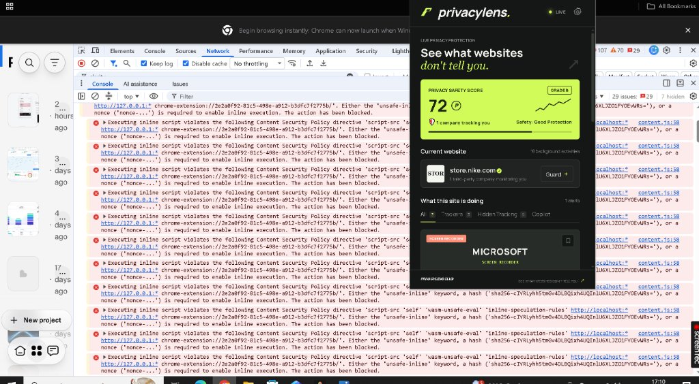
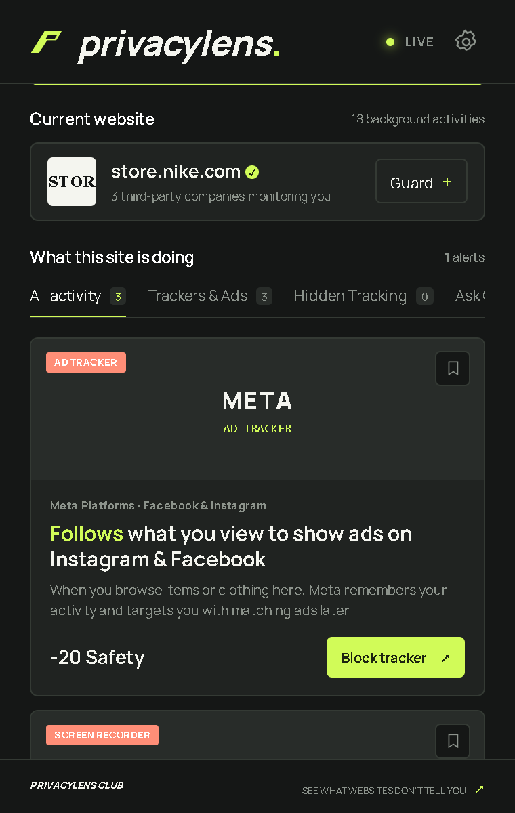
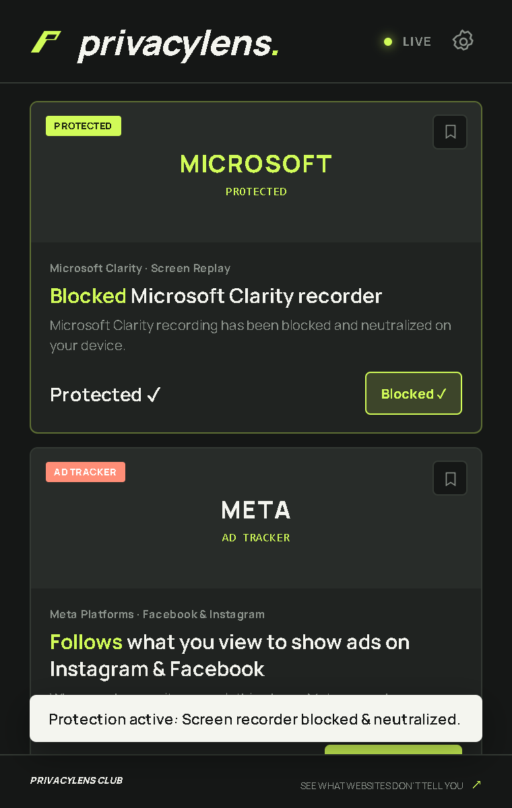
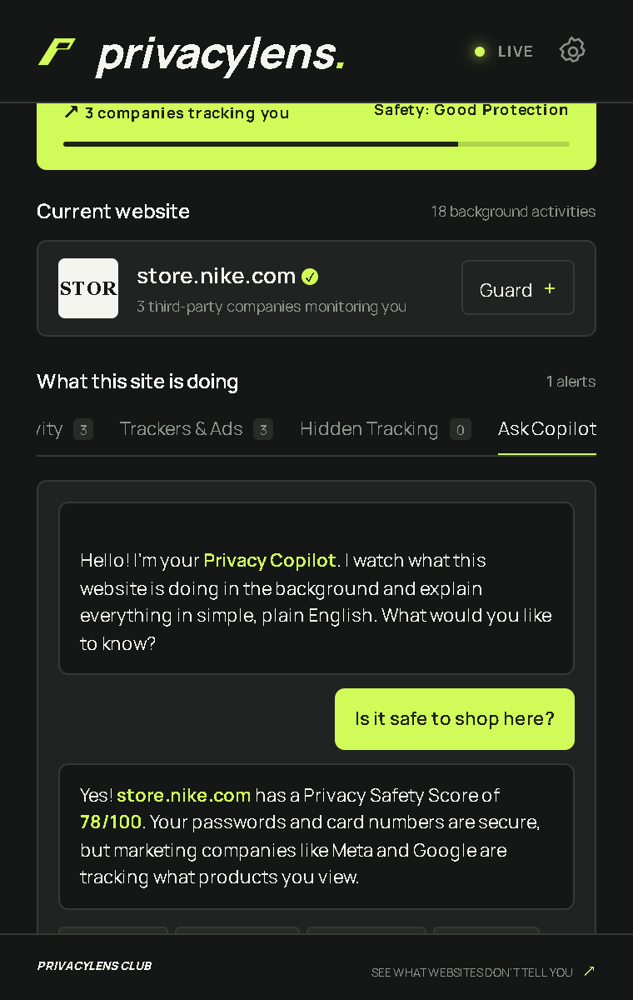
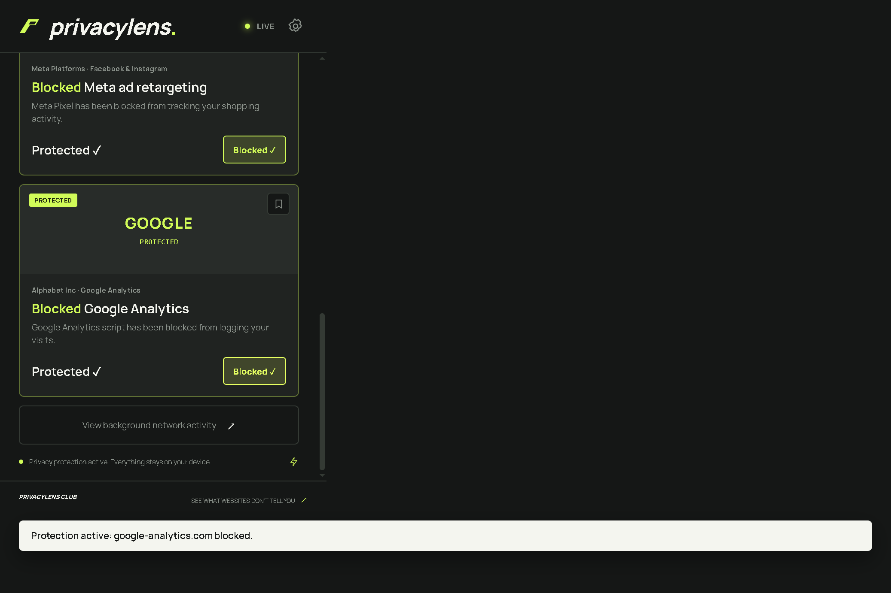

<div align="center">
  <a href="https://github.com/AryanMohite0/PrivacyLens">
    
  </a>
</div>

<p align="center">
  <strong>See what websites don't tell you.</strong><br/>
  Evidence-backed, open-source AI privacy inspector comparing actual browser behavior against published privacy policies.
</p>

<div align="center">

[](LICENSE)
[](privacylens-extension)
[](apps/api)
[](infrastructure/docker/Modelfile.gemma4)
[](infrastructure/zeek/privacylens.zeek)
[](apps/api/app/services/stgnn_engine.py)

</div>

---

## Visual Showcase

### Live In-Browser Telemetry & Inspection
<div align="center">
  
  <p><em>Live PrivacyLens inspector running in Google Chrome — observing background network traffic, evaluating third-party tracking, and updating the dynamic Privacy Safety Score in real-time.</em></p>
</div>
<br/>

<div align="center">
  
  
</div>
<br/>
<div align="center">
  
  
</div>

---

<div align="center">
  
</div>
<br/>

Ordinary privacy tools merely summarize lengthy privacy policies without knowing if the website actually follows them. **PRIVACYLENS** is built differently: it observes a website's live client-side and network wire behavior, extracts structured commitments with **Gemma 4**, validates evasive graph exfiltration via **STGNN**, and identifies the **Privacy Reality Gap** with mathematically grounded evidence.

```
┌────────────────────────────────────────────────────────┐
│               1. DETERMINISTIC CLIENT ENGINE           │
│ • Passive chrome.webRequest metadata observation       │
│ • Instant DeclarativeNetRequest (DNR) active blocking  │
│ • eTLD+1 first vs. third-party domain resolution       │
│ • In-page DOM recorder neutralization (Clarity/Hotjar) │
└───────────────────────────┬────────────────────────────┘
                            │ Observed Telemetry Events
┌───────────────────────────▼────────────────────────────┐
│         2. WIRE-LEVEL AUDITOR & STGNN ENGINE           │
│ • Zeek protocol wire parser (dns.log, http.log, ssl)   │
│ • CNAME cloaking & uncloaked IP resolution             │
│ • Spatio-Temporal Graph Neural Network (STGNN)         │
│ • Exfiltration path analysis & evasive classification  │
└───────────────────────────┬────────────────────────────┘
                            │ Correlated Wire Artifacts
┌───────────────────────────▼────────────────────────────┐
│            3. POLICY INTELLIGENCE (GEMMA 4)            │
│ • Legal policy commitment extraction into strict JSON  │
│ • Collection, sharing, retention & ad disclosures      │
│ • Plain-English conversational evidence copilot        │
│ • Contradiction flag & Reality Gap audit               │
└────────────────────────────────────────────────────────┘
```

---

## 2. Monorepo Structure

```
PRIVACYLENS/
├── privacylens-extension/   # Standalone zero-build Chrome MV3 Extension (Dark Obsidian UI)
├── privacylens-extension.zip# Ready-to-load packaged extension archive
├── apps/
│   ├── api/                 # FastAPI backend (Gemma 4, Zeek Parser, STGNN Engine)
│   ├── dashboard/           # Next.js 14 companion web intelligence dashboard
│   └── extension/           # React/Vite development workspace for extension
├── intelligence/
│   ├── tracker_database/    # Curated tracker registry with parent corporate entities
│   ├── domain_classifier/   # eTLD+1 root domain classifier
│   └── risk_engine/         # Deterministic scoring engine implementation
├── infrastructure/
│   ├── docker/              # Dockerfile.api, Dockerfile.zeek, Modelfile.gemma4
│   └── zeek/                # privacylens.zeek wire protocol sniffer script
├── packages/
│   └── shared/              # Shared TypeScript schemas, risk types & URL sanitizer
├── docs/
│   ├── architecture/        # Full technical specification & mathematical models
│   └── assets/              # UI screenshots and visual walkthroughs
├── datasets/                # Sample privacy policies and synthetic benchmark cases
├── docker-compose.yml
└── ARCHITECTURE.md
```

---

<div align="center">
  
</div>
<br/>

The privacy assessment is calculated through a calibrated, deterministic formula:

$$\text{Risk Score } R = 0.35T + 0.25C + 0.15P + 0.25D$$
$$\text{Privacy Safety Score} = 100 - R$$

Where:
* **$T$ (Tracking Exposure)**: Presence of session replays (Microsoft Clarity, FullStory), ad retargeting pixels (Meta, TikTok), and visitor analytics. When trackers are blocked, their penalty is dynamically removed in real-time.
* **$C$ (Cookie & Storage Exposure)**: Third-party cookies, persistent retention (>180 days), and permanent identifiers surviving cookie clears.
* **$P$ (Permission Exposure)**: High-risk browser permissions (Geolocation, Camera, Microphone).
* **$D$ (Disclosure Concerns & Reality Gap)**: Missing privacy policy, or hidden tracking discrepancies where trackers operate without explicit policy disclosure.

---

## 4. Quick Start & Setup

### Prerequisites
* **Node.js**: v20+ (tested on v24.19.0)
* **Python**: 3.11+ (tested on 3.12.10)
* **Google Chrome** or **Microsoft Edge** browser

### 1. Install & Run Tests
```bash
# Clone the repository
git clone https://github.com/AryanMohite0/PrivacyLens.git
cd PrivacyLens

# Install Node workspace dependencies
npm install

# Run TypeScript intelligence test suite (8 tests)
npm test

# Run Python backend test suite (15 tests: Zeek, STGNN, Gemma, Scans)
$env:PYTHONPATH = "."; & apps/api/.venv/Scripts/pytest apps/api/tests
```

### 2. Loading the Chrome Extension
1. Open Google Chrome and navigate to `chrome://extensions`.
2. Enable **Developer mode** (top-right toggle).
3. Click **Load unpacked** and select the folder:
   ```
   privacylens-extension
   ```
   *(Alternatively, extract `privacylens-extension.zip` and load it directly).*
4. Pin **PRIVACYLENS** to your browser toolbar and open any website (e.g. `store.nike.com`).
5. Click **Block recorder** on Microsoft Clarity or **Block tracker** on Meta Pixel to see instant score increases and DNR neutralization.

### 3. Running the FastAPI Backend
```bash
# Activate virtual environment
apps/api/.venv/Scripts/activate

# Run FastAPI server
uvicorn apps.api.app.main:app --reload --port 8000
```
API Documentation is live at: `http://localhost:8000/docs`

### 4. Running the Web Intelligence Dashboard
```bash
npm --workspace=@privacylens/dashboard run start -- -p 3001
```
Open `http://localhost:3001` to view the Live Monitor, Tracker Intelligence Graph, and Policy Analyzer.

---

## 5. Security & Privacy Non-Negotiables

* **Local-First Processing**: Raw network observations and cookie data remain in local browser memory.
* **Zero Telemetry Leaks**: Sensitive query tokens, credentials, and passwords are fully scrubbed with entropy redaction before any scoring or logging.
* **Instant Reversible Blocking**: Tracker and recorder blocking uses native Chrome `declarativeNetRequest` rules with immediate fallback neutralization.
* **Grounded AI Copilot**: Gemma 4 citations strictly reference verified telemetry IDs and extracted legal excerpts with zero speculation.

---

## 6. License

Released under the [MIT License](LICENSE).
